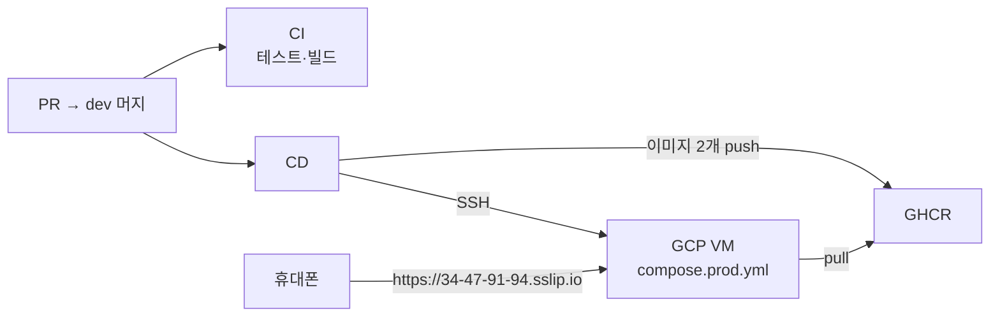

# 배포·인프라 설명서

이 문서는 이치마디가 어디에서 어떻게 돌아가는지 설명합니다. 전문용어는 처음 나올 때 괄호 안에 한 줄로 풀이했습니다. 담당은 현우입니다.

- 서비스 주소: **https://34-47-91-94.sslip.io**
- 결정 기록: [ADR-005](adr/ADR-005-single-vm-same-origin-deploy.md)

## 목차

1. [한눈에 보기](#1-한눈에-보기)
2. [파일 위치](#2-파일-위치)
3. [CI: PR마다 검사하는 것](#3-ci-pr마다-검사하는-것)
4. [CD: dev에 머지되면 일어나는 일](#4-cd-dev에-머지되면-일어나는-일)
5. [GitHub secrets](#5-github-secrets)
6. [서버 .env](#6-서버-env)
7. [체험용 계정 발급](#7-체험용-계정-발급)
8. [DB 백업과 복구](#8-db-백업과-복구)
9. [롤백](#9-롤백)
10. [서버에서 자주 쓰는 명령](#10-서버에서-자주-쓰는-명령)
11. [문제 해결](#11-문제-해결)

---

## 1. 한눈에 보기



서버는 **GCP VM**(구글 클라우드에서 빌려 쓰는 가상 컴퓨터) 1대입니다. 서울 리전의 e2-small(RAM 2GB)이고, 이 안에서 컨테이너 3개가 돌아갑니다.

```
사용자 ──https──▶ web (Caddy) ── /api/* ──▶ api (FastAPI :8000) ──▶ db (PostgreSQL 16)
                     └─ 그 외 경로 → 프론트 화면 (index.html, /assets)
```

| 컨테이너 | 하는 일 | 외부 공개 | 메모리 상한 |
| --- | --- | --- | --- |
| `web` | HTTPS 인증서 자동 발급, 프론트 화면 제공, `/api/*` 를 api로 전달 | 80, 443 | 256MB |
| `api` | FastAPI | 안 함 | 512MB |
| `db` | PostgreSQL 16 | 안 함 | 512MB |

- **Caddy**는 HTTPS를 자동으로 처리해 주는 웹 서버입니다. 여기서는 **리버스 프록시**(바깥 요청을 받아 안쪽 서버로 넘겨 주는 중간 서버) 역할도 합니다.
- 화면과 API가 **같은 주소**를 쓰기 때문에 **CORS**(브라우저가 다른 주소의 API를 부를 때 하는 보안 확인) 설정이 필요 없습니다. 프론트는 항상 `/api/...` 만 부르면 됩니다.
- **sslip.io**는 IP 주소를 도메인처럼 쓰게 해 주는 무료 서비스입니다. `34-47-91-94.sslip.io` 는 `34.47.91.94` 로 연결됩니다.

---

## 2. 파일 위치

| 파일 | 역할 |
| --- | --- |
| `compose.prod.yml` | 서버용 구성 (web + api + db). 로컬 개발용 `docker-compose.yml` 과는 별개 |
| `Caddyfile` | 주소와 경로별 전달 규칙 |
| `deploy/web.Dockerfile` | 프론트를 빌드해서 Caddy 이미지에 넣는 설계도 (빌드 기준 폴더는 레포 루트) |
| `deploy/remote-deploy.sh` | 배포할 때 서버에서 실행되는 스크립트 |
| `deploy/.env.example` | 서버에 둘 `.env` 예시 |
| `.github/workflows/ci.yml` | CI |
| `.github/workflows/cd.yml` | CD |

API 이미지는 `backend/Dockerfile` 을 그대로 씁니다.

---

## 3. CI: PR마다 검사하는 것

**CI**(Continuous Integration: 코드가 올라올 때마다 자동으로 검사하는 것)는 PR을 열거나 커밋을 추가할 때, 그리고 `dev`·`main` 에 push될 때 실행됩니다. **paths filter**(바뀐 파일 경로를 보고 필요한 검사만 고르는 기능)로 바뀐 쪽만 검사합니다.

| job | 언제 | 하는 일 |
| --- | --- | --- |
| `backend (ruff + pytest)` | `backend/**`, `content/**` 변경 | `ruff check`, `ruff format --check`, `pytest` (PostgreSQL 16을 붙여서 DB 테스트까지), API 이미지 빌드 확인 |
| `frontend (test + build)` | `frontend/**`, `content/**` 변경 | `node --test "tests/**/*.test.ts"`, `npm run build`, web 이미지 빌드 확인 |
| `deploy config (validate)` | `compose.prod.yml`, `Caddyfile`, `deploy/**` 변경 | Caddyfile 문법, compose 형식, 배포 스크립트(shellcheck) 검사 |
| `ci-result` | 항상 | 위 결과를 모아 하나로 판정합니다. 건너뛴 job은 통과로 봅니다. |

브랜치 보호를 켠다면 **필수 체크는 `ci-result` 하나만** 지정합니다. 각 job을 직접 지정하면, 해당 영역을 건드리지 않은 PR이 "대기 중"에서 멈춥니다.

> 참고: `frontend/package.json` 의 `npm test`(`node --test tests/`)는 Linux에서 폴더를 파일로 읽어서 실패합니다. 그래서 CI는 파일 패턴으로 직접 실행합니다.

---

## 4. CD: dev에 머지되면 일어나는 일

**CD**(Continuous Delivery/Deployment: 검사를 통과한 코드를 자동으로 배포하는 것)는 `dev` 에 `backend/`, `frontend/`, `content/`, 배포 설정 중 하나라도 바뀐 커밋이 들어오면 실행됩니다. Actions 탭 → **CD** → **Run workflow** 로 수동 실행도 할 수 있습니다.

```
prepare ─┐
test (backend) ─┼─▶ image (api) ─┐
test (frontend) ┘   image (web) ─┴─▶ deploy to server
                                      (DEPLOY_HOST secret 이 없으면 건너뜀)
```

1. **test**: 백엔드 pytest와 프론트 테스트를 실행합니다. 실패하면 멈춥니다.
2. **image**: 이미지 2개를 만들어 **GHCR**(GitHub이 제공하는 Docker 이미지 저장소)에 올립니다.
   - `ghcr.io/<레포 주인 소문자>/ichimadi-api`, `ghcr.io/<레포 주인 소문자>/ichimadi-web`
   - 태그는 `sha-1a2b3c4`(커밋별 고정 버전)와 `latest` 입니다. 두 이미지는 항상 같은 태그로 만들어집니다.
3. **deploy to server**
   1. `compose.prod.yml`, `Caddyfile`, `content/` 를 서버에 올립니다. 서버의 `.env` 는 건드리지 않습니다.
   2. 서버에서 이미지 2개를 받습니다. GHCR 로그인에는 이번 실행에만 유효한 임시 토큰을 쓰고, 끝나면 로그아웃합니다.
   3. db를 먼저 띄우고 `alembic upgrade head`(DB 구조 업데이트)와 `python -m scripts.seed`(한마디 콘텐츠 넣기)를 실행합니다. API는 시작할 때 이 작업을 하지 않기 때문입니다. 시드는 여러 번 실행해도 중복되지 않습니다.
   4. 전체를 재시작하고, api가 healthy(헬스체크 통과)가 될 때까지 기다립니다.
   5. 실제 사용자와 같은 경로(HTTPS → Caddy → api)로 `/`, `/api/health`, `/version.txt` 를 확인합니다. 방금 배포한 커밋이 떠 있는지까지 확인합니다.
   6. 하나라도 실패하면 로그를 출력하고 실패로 처리합니다. 성공하면 실행 요약에 주소가 남습니다.

배포된 프론트의 커밋은 https://34-47-91-94.sslip.io/version.txt 에서 볼 수 있습니다.

---

## 5. GitHub secrets

**Secret**(비밀번호나 키처럼 코드에 적으면 안 되는 값)은 레포 → **Settings → Secrets and variables → Actions** 에 등록합니다. 레포 관리자만 등록할 수 있습니다. 값은 현우에게 따로 받습니다.

| 이름 | 필수 | 값 | 설명 |
| --- | --- | --- | --- |
| `DEPLOY_HOST` | 필수 | `34.47.91.94` | **없으면 배포 단계를 건너뜁니다.** |
| `DEPLOY_USER` | 필수 | `deploy` | 서버 SSH 사용자 |
| `DEPLOY_SSH_KEY` | 필수 | 배포 전용 SSH 개인키 전체 | 첫 줄부터 마지막 줄까지 그대로 |
| `DEPLOY_KNOWN_HOSTS` | 권장 | 서버 공개키 (`ssh-keyscan -H 34.47.91.94` 출력) | 가짜 서버 접속을 막습니다. |
| `DEPLOY_PORT` | 선택 | `22` | 없으면 22 |
| `DEPLOY_PATH` | 선택 | `/home/deploy/ichimadi` | 없으면 홈 폴더의 `ichimadi` |

gh CLI로 등록하는 예시입니다.

```bash
gh secret set DEPLOY_HOST -R OurVacation/ichimadi --body "34.47.91.94"
gh secret set DEPLOY_USER -R OurVacation/ichimadi --body "deploy"
gh secret set DEPLOY_SSH_KEY -R OurVacation/ichimadi < 받은_개인키_파일
gh secret set DEPLOY_KNOWN_HOSTS -R OurVacation/ichimadi < 받은_known_hosts_파일
```

**(선택) 레포 변수 `VITE_TRIAL_ACCOUNTS`**: 프론트가 백엔드 로그인에 연결되기 전까지 쓰는 체험 계정입니다(`아이디:비밀번호,…`). 레포 → Settings → Secrets and variables → Actions → **Variables** 탭에 넣으면 web 이미지 빌드에 들어갑니다. **빌드된 JS에 그대로 들어가서 누구나 볼 수 있으므로**, 실제 심사위원 계정의 비밀번호는 절대 넣지 않습니다.

---

## 6. 서버 .env

서버의 `~/ichimadi/.env` 에 있습니다. 권한은 600(deploy 사용자만 읽기)이고, git에는 올리지 않습니다. 예시는 `deploy/.env.example` 입니다.

| 키 | 값 | 설명 |
| --- | --- | --- |
| `SITE_ADDRESS` | `34-47-91-94.sslip.io` | 사이트 주소. Caddy가 이 이름으로 인증서를 받습니다. |
| `POSTGRES_DB` / `POSTGRES_USER` | `ichimadi` | DB 이름과 사용자 |
| `POSTGRES_PASSWORD` | 무작위 값 | DB 비밀번호 |
| `APP_ENV` | `prod` | prod에서는 기본 개발용 `JWT_SECRET` 으로 시작하면 거부됩니다. |
| `JWT_SECRET` | 무작위 긴 값 | 로그인 토큰 서명 키. 바꾸면 기존 로그인이 모두 풀립니다. |
| `CORS_ORIGINS` | `["https://34-47-91-94.sslip.io"]` | 같은 주소라 사실상 필요 없지만 명시해 둡니다. |
| `GEMINI_API_KEY` | 설정됨 (서버에만) | 이름 추천용 키. 비어 있거나 Gemini가 응답하지 않으면 이름 추천이 503 `name_suggest_unavailable` 을 돌려주고, FE는 임시 이름 생성기로 대신합니다. |
| `GEMINI_MODEL` | `gemini-3.6-flash` | 팀 기본값 `gemini-3.8-flash` 는 무료 등급 키로 호출하면 503·시간 초과만 나서(2026-11-27 확인), 응답하는 가장 가까운 flash 모델로 지정했습니다. |
| `IMAGE_PREFIX` | `ghcr.io/ourvacation` | 서버에서 직접 `docker compose` 를 실행할 때 쓸 이미지 위치. CD는 자기 값을 넘깁니다. |

> 키 출처: 현우 개인 계정 무료 등급, 무료 등급은 분당/일일 호출 제한이 있고 입력이 학습에 쓰일 수 있음

`DATABASE_URL` 은 `.env` 에 적지 않습니다. `compose.prod.yml` 이 `POSTGRES_*` 값으로 만들어서 api에 넘깁니다.

`.env` 를 바꾼 뒤에는 서버에서 `docker compose -f compose.prod.yml up -d` 를 실행해야 반영됩니다.

---

## 7. 체험용 계정 발급

계정은 회원가입 없이 스크립트로 미리 만듭니다(`backend/scripts/create_accounts.py`). 서버에 SSH로 접속해서 실행합니다.

```bash
ssh -i ~/.ssh/ichimadi_deploy deploy@34.47.91.94
cd ~/ichimadi
mkdir -p accounts && chmod 700 accounts

# 예) 심사위원 계정 12개 (j01 ~ j12)
docker compose -f compose.prod.yml run --rm --no-deps \
  --user "$(id -u):$(id -g)" -v "$PWD/accounts:/accounts" \
  api python -m scripts.create_accounts --prefix j --count 12 --role judge \
  --out /accounts/judge.accounts.csv
```

- `--user "$(id -u):$(id -g)"` 와 `-v ...:/accounts` 는 꼭 붙입니다. 컨테이너 안의 앱 폴더에는 쓰기 권한이 없어서, 이 옵션이 없으면 CSV를 쓰지 못하고 실패합니다.
- 이미 있는 아이디는 건너뛰고, 같은 이름의 CSV가 있으면 덮어쓰지 않고 실패합니다. 다시 발급할 때는 `--out` 파일 이름을 바꿉니다.
- CSV를 내 PC로 가져오려면 다음 명령을 씁니다. CSV에는 비밀번호가 들어 있으니 **git에 올리지 않고, 채팅방에 그대로 붙이지 않습니다.**

  ```bash
  scp -i ~/.ssh/ichimadi_deploy deploy@34.47.91.94:ichimadi/accounts/judge.accounts.csv .
  ```

- 역할(`--role`)은 `judge`, `spare`, `team`, `demo` 중 하나입니다. 통계에는 judge와 spare만 집계됩니다.
- 도장이나 프로필을 초기화하는 `scripts.reset` 도 같은 방식으로 실행합니다. 사용법은 README의 "백엔드 사용"(PR #5)을 참고합니다.

QR 카드는 내 PC의 `frontend/` 에서 만듭니다.

```bash
npm run qr -- --base-url https://34-47-91-94.sslip.io --accounts-file <id:password 형식 파일>
```

---

## 8. DB 백업과 복구

본선 전날과 시작 직전에 한 번씩 백업하는 것을 권장합니다.

```bash
cd ~/ichimadi && mkdir -p backups
docker compose -f compose.prod.yml exec -T db sh -c 'pg_dump -U "$POSTGRES_USER" -d "$POSTGRES_DB"' \
  > "backups/ichimadi-$(date +%F-%H%M).sql"
```

복구할 때는 API를 잠시 멈추고 백업 파일을 넣습니다. **기존 데이터 위에 덮어쓰므로 신중하게 실행합니다.**

```bash
docker compose -f compose.prod.yml stop api
docker compose -f compose.prod.yml exec -T db sh -c 'psql -U "$POSTGRES_USER" -d "$POSTGRES_DB"' < backups/<파일>.sql
docker compose -f compose.prod.yml start api
```

---

## 9. 롤백

**롤백**(rollback: 문제가 생겼을 때 이전 버전으로 되돌리는 것)은 두 가지 방법이 있습니다.

- **방법 1 (권장)**: GitHub에서 문제가 된 PR을 **Revert** 하고 `dev` 에 머지합니다. CD가 자동으로 다시 배포합니다.
- **방법 2 (급할 때 서버에서)**: 이전 커밋의 태그로 실행합니다. web과 api가 함께 되돌아갑니다. GHCR 이미지가 비공개라면 먼저 PAT로 `docker login ghcr.io` 를 해야 합니다.

  ```bash
  cd ~/ichimadi
  APP_TAG=sha-이전커밋 docker compose -f compose.prod.yml up -d
  ```

  DB 구조(마이그레이션)는 자동으로 되돌아가지 않습니다. 마이그레이션이 포함된 변경을 되돌릴 때는 태원과 먼저 상의합니다.

---

## 10. 서버에서 자주 쓰는 명령

```bash
ssh -i ~/.ssh/ichimadi_deploy deploy@34.47.91.94
cd ~/ichimadi
docker compose -f compose.prod.yml ps            # 상태
docker compose -f compose.prod.yml logs -f api   # API 로그
docker compose -f compose.prod.yml logs web      # Caddy 로그 (인증서 발급 등)
docker stats --no-stream                         # 메모리 사용량
free -h && df -h /                               # 서버 메모리·디스크
```

---

## 11. 문제 해결

| 증상 | 원인과 해결 |
| --- | --- |
| PR에서 `ci-result` 가 빨간색 | 그 위의 job 중 실패한 것을 열어 봅니다. 로컬에서 같은 명령(`uv run ruff check .`, `uv run pytest`, `npm run build`)으로 재현할 수 있습니다. |
| CD 요약에 "서버 배포 건너뜀" | `DEPLOY_HOST` secret이 없을 때의 정상 동작입니다. |
| deploy job에서 `Permission denied (publickey)` | `DEPLOY_USER`, `DEPLOY_SSH_KEY` 값을 확인합니다. |
| deploy job에서 `Host key verification failed` | VM을 다시 만들었거나 IP가 바뀌었습니다. `DEPLOY_KNOWN_HOSTS` 를 다시 등록합니다. |
| `컨테이너가 정상 상태가 되지 않았습니다` | 출력된 api 로그를 봅니다. DB 접속 오류나 `JWT_SECRET must be changed in production` 이면 서버 `.env` 문제입니다. |
| 화면은 뜨는데 로그인·도장이 안 됨 | `docker compose -f compose.prod.yml logs api` 를 확인합니다. |
| 브라우저에 `502 Bad Gateway` | Caddy는 살아 있지만 api가 응답하지 않는 상태입니다. api 로그를 확인합니다. |
| 이름 추천이 항상 503 | `GEMINI_API_KEY` 가 비어 있으면 정상입니다. 키를 넣으려면 `.env` 를 고치고 `up -d` 를 실행합니다. |
| `https://` 가 열리지 않거나 인증서 오류 | GCP 방화벽 80/443, `.env` 의 `SITE_ADDRESS` 를 확인하고 `logs web` 에서 인증서 발급 로그를 봅니다. |
